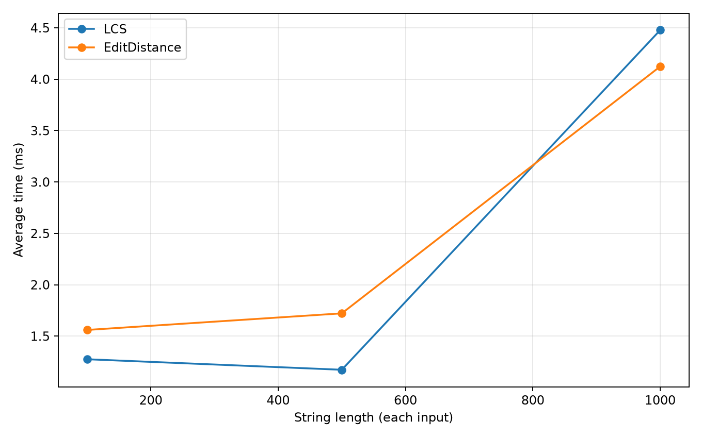
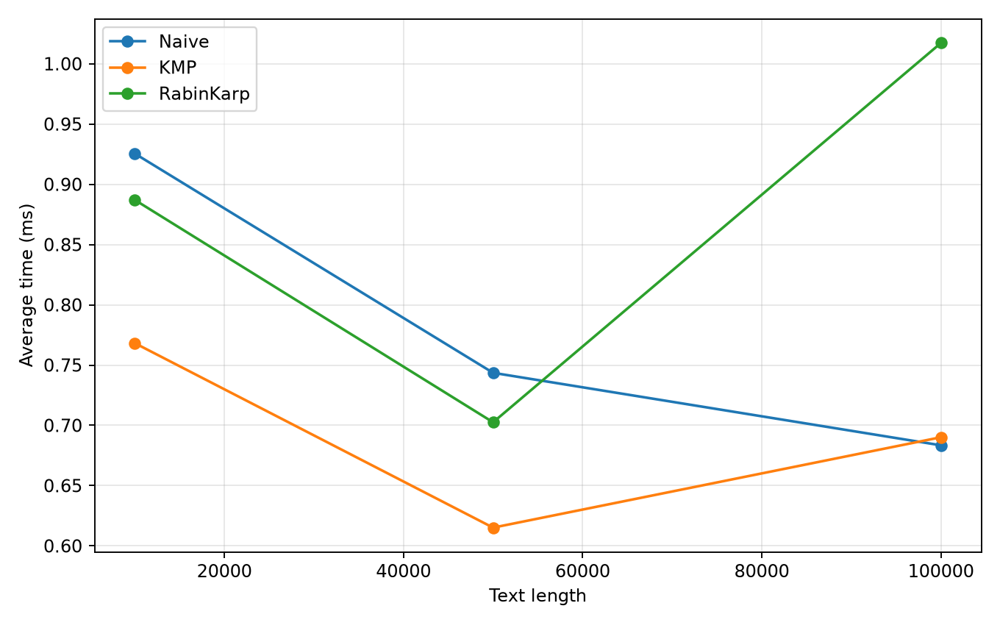
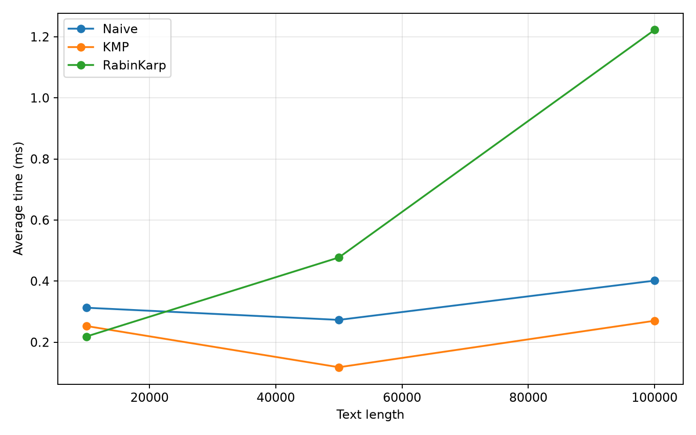
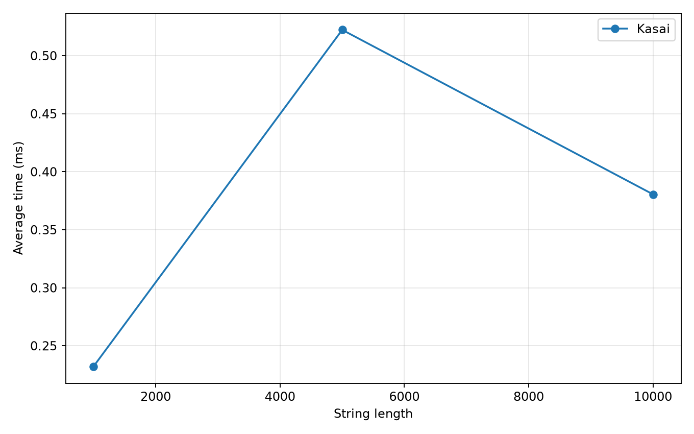

# Assignment 4 — Text Analysis: Dynamic Programming and String Algorithms

## 1. Objective and overview
This Java 21 project implements six algorithms from scratch: **Longest Common Subsequence (LCS)**, **Levenshtein Edit Distance**, **Naive string matching**, **Knuth–Morris–Pratt (KMP)**, **Rabin–Karp**, and **Kasai's LCP algorithm**. It compares theoretical complexity with measured execution time and includes reproducible correctness tests and fixed-size experiments.

## 2. Structure and reproducibility
```
src/textanalysis/Algorithms.java  # algorithm implementations
src/textanalysis/Tests.java       # correctness tests and randomized cross-checks
src/textanalysis/Benchmark.java   # timed experiments and CSV output
plot_results.py                   # plots from real benchmark CSV
results/benchmark.csv             # measured results from Java 21 environment
plots/                            # generated figures
run.sh                            # compile, test, benchmark, plot
```

Requirements: JDK 17+ (tested with OpenJDK 21), Python 3 and matplotlib. Run from repository root:

```bash
./run.sh
```

Or run Java only:

```bash
mkdir -p out
javac -d out src/textanalysis/*.java
java -cp out textanalysis.Tests
java -cp out textanalysis.Benchmark
```

Run `python3 plot_results.py` after the benchmark to regenerate the figures. All Java code uses the standard library only. `.gitignore` excludes compiled classes. The included measurements are one real run on the execution environment and may differ on other machines.

## 3. Implementations, recurrences, and correctness

**LCS:** Let `dp[i][j]` be the LCS length of the first `i` and `j` characters. Base cases `dp[i][0]=dp[0][j]=0`. If the last characters match, `dp[i][j]=1+dp[i-1][j-1]`; otherwise `dp[i][j]=max(dp[i-1][j],dp[i][j-1])`. Correctness: a matching final character can extend an optimal subsequence of the prefixes; when the final characters differ, an optimal common subsequence must omit at least one of them. Bottom-up evaluation computes smaller prefixes first.

**Edit Distance:** Let `dp[i][j]` be the fewest edits from prefix `a[:i]` to `b[:j]`. Base cases `dp[i][0]=i`, `dp[0][j]=j`. For positive indices:

`dp[i][j] = min(dp[i-1][j]+1, dp[i][j-1]+1, dp[i-1][j-1]+(a[i-1]==b[j-1] ? 0 : 1))`.

The three choices represent deletion, insertion, and match/substitution. Any optimal transformation ends in one of these choices; each uses an optimal smaller-prefix solution. Therefore induction proves the recurrence.

**Naive matching:** Try every feasible starting index and compare characters until mismatch or full match. Count comparisons performed, including the mismatching character.

**KMP:** Compute `lps[i]`, the longest proper prefix of `pattern[0..i]` that is also a suffix. On mismatch, reuse the known matching prefix by setting `j=lps[j-1]`, rather than restarting at the next text index. This avoids rechecking text positions and makes the search linear. Comparisons in the search are counted; LPS preprocessing comparisons are not included in the operation count, although preprocessing *is* included in timed calls.

**Rabin–Karp:** Polynomial rolling hash with base 257 and prime modulus 1,000,000,007. Hash the pattern and each text window. Equal hashes are **always verified character by character**, so hash collisions cannot produce false matches. The count records verification character comparisons only, not hash arithmetic. Hashing uses Java `long` to avoid overflow in intermediate operations for these constants.

**Kasai:** Input is the original string and a suffix array already sorted lexicographically. Create inverse `rank`, then compute the common prefix length between each suffix and its preceding suffix in suffix-array order. Reuse `h-1` from the previous step: removing the first character decreases the possible common prefix by at most one. Here `lcp[0]=0`, and `lcp[r]=LCP(suffix(sa[r-1]),suffix(sa[r]))`. The suffix-array builder supplied for experimental input preparation is a simple comparator-based reference method, **not part of the timed Kasai algorithm**. Kasai validates that the supplied indices form a permutation but assumes they are sorted correctly.

## 4. Assumptions and edge cases
- Java UTF-16 `char` values are used as string units; the experiments use ASCII only.
- Empty pattern matches at every boundary, indices `0..text.length()` inclusive, for all three search algorithms.
- Matching indices are zero-based; overlapping occurrences are included.
- For Kasai, suffix array is supplied as an input; empty string gives empty arrays.
- Experimental alphabet is **`a,b,c,d`** for all random strings; the absent matching pattern is 16 `z` characters, deliberately outside that alphabet. Fixed random seed **20261025**. The present pattern is a 16-character substring centered in the text.

## 5. Complexity analysis
Here `n,m` are input string lengths, `N` is text length, `M` is pattern length, and `S` is the length of the string passed to Kasai. Auxiliary space excludes input and returned occurrence lists but includes algorithm tables/arrays.

| Algorithm | Main operation / recurrence | Best-case time | Worst-case time | Auxiliary space | Reason |
|---|---|---|---|---|---|
| LCS | Prefix DP match/maximum | O(nm) | O(nm) | O(nm) | All table cells evaluated |
| Edit Distance | Prefix DP minimum of 3 choices | O(nm) | O(nm) | O(nm) | All table cells evaluated |
| Naive | Compare pattern at every start | O(N) for nonempty fixed-size pattern with N≥M | O((N-M+1)M) | O(1) | Early mismatch vs. full checks at each start |
| KMP | LPS preprocessing + prefix fallback | O(N+M) | O(N+M) | O(M) | Text advances or matched prefix shrinks; no repeated full scans |
| Rabin–Karp | Rolling hash + verify equal hashes | Expected O(N+M) | O((N-M+1)M+M) | O(1) | Hash collisions or many equal windows cause verification; expected bound assumes few verifications |
| Kasai (given SA) | Rank array and amortized prefix scan | O(S) | O(S) | O(S) | Match length decreases by at most one per suffix, yielding amortized linear work |

For Naive, if `M>N` it returns immediately in O(1) (not counting input creation); if `M=0`, returning all boundaries costs O(N) time and output space. For KMP and Rabin–Karp, empty-pattern output similarly costs O(N) time/output space; if `M>N`, KMP still preprocesses in O(M), while Rabin–Karp returns in O(1). Complexity bounds concern asymptotic growth, **not measured wall-clock milliseconds**. The expected Rabin–Karp bound depends on collision/verification behavior, while its worst case does not.

## 6. Correctness testing
`Tests.java` covers LCS identical/different/empty; edit distance identical/empty/substitution/insertion/deletion; string matching beginning/middle/end, overlaps, absent, longer-than-text, empty pattern and empty text. Every matching case compares **all three algorithms** against the same expected list. An additional 150 seeded randomized cases cross-check the matching algorithms. For `banana`, manually verified suffix array is `[5,3,1,0,4,2]` and LCP array is `[0,1,3,0,0,2]`. Executed test suite: **490 assertions passed**.

## 7. Experimental design
Fixed workloads from the assignment:

| Experiment | Sizes |
|---|---|
| LCS | two strings, each length 100, 500, 1000 |
| Edit Distance | two strings, each length 100, 500, 1000 |
| String matching | text length 10000, 50000, 100000; pattern present and absent |
| Kasai | string length 1000, 5000, 10000 |

Each timed algorithm invocation is repeated **5 times** and arithmetic mean is reported. `System.nanoTime()` surrounds only the algorithm call (including KMP preprocessing and Rabin–Karp hashing). Random data generation, suffix-array construction, CSV writing, console printing, and plotting are excluded. Each matcher receives exactly the same text/pattern in each scenario. A volatile checksum sink prevents results being trivially unused. Two untimed warmup invocations precede the five measured invocations for each workload. JVM JIT compilation, GC, OS scheduling, and CPU variation can still affect short timings. Operation counts are collected separately from timed regions: DP counts filled interior cells, Naive/KMP count search character comparisons, Rabin–Karp counts verification character comparisons after hash equality (not hash arithmetic), and Kasai counts character comparisons in its LCP scan. Counts are not directly comparable across algorithm families. CSV times are milliseconds.

### Measurement environment

- CPU: AMD EPYC 9V74 (virtualized/cloud CPU; physical host details unavailable).
- RAM visible to the container: approximately 5.8 GiB; actual available RAM varies.
- OS: Linux container (Debian-based runtime).
- Java: OpenJDK 21.0.12.1, 64-bit Server VM.
- Measurements are from this container, not the student's personal computer. They should be rerun on the final machine if local hardware details are needed.

### Actual measured results

The tables below are generated from the included **real** `results/benchmark.csv` measurements. Times are arithmetic means in milliseconds across five measured runs, after two warmup invocations. These are observations, not theoretical guarantees.

#### Dynamic programming

| Algorithm | Input size | Mean time (ms) | Operations* |
|---|---:|---:|---:|
| LCS | 100 | 1.2754 | 10,000 |
| EditDistance | 100 | 1.5605 | 10,000 |
| LCS | 500 | 1.1730 | 250,000 |
| EditDistance | 500 | 1.7218 | 250,000 |
| LCS | 1,000 | 4.4776 | 1,000,000 |
| EditDistance | 1,000 | 4.1238 | 1,000,000 |

#### String matching — present

| Algorithm | Input size | Mean time (ms) | Operations* |
|---|---:|---:|---:|
| Naive | 10,000 | 0.9255 | 13,347 |
| KMP | 10,000 | 0.7682 | 12,445 |
| RabinKarp | 10,000 | 0.8870 | 16 |
| Naive | 50,000 | 0.7436 | 66,575 |
| KMP | 50,000 | 0.6151 | 62,489 |
| RabinKarp | 50,000 | 0.7025 | 16 |
| Naive | 100,000 | 0.6834 | 133,390 |
| KMP | 100,000 | 0.6901 | 124,143 |
| RabinKarp | 100,000 | 1.0172 | 16 |

#### String matching — absent

| Algorithm | Input size | Mean time (ms) | Operations* |
|---|---:|---:|---:|
| Naive | 10,000 | 0.3129 | 9,985 |
| KMP | 10,000 | 0.2530 | 10,000 |
| RabinKarp | 10,000 | 0.2186 | 0 |
| Naive | 50,000 | 0.2731 | 49,985 |
| KMP | 50,000 | 0.1180 | 50,000 |
| RabinKarp | 50,000 | 0.4775 | 0 |
| Naive | 100,000 | 0.4016 | 99,985 |
| KMP | 100,000 | 0.2702 | 100,000 |
| RabinKarp | 100,000 | 1.2226 | 0 |

#### Kasai

| Algorithm | Input size | Mean time (ms) | Operations* |
|---|---:|---:|---:|
| Kasai | 1,000 | 0.2322 | 1,991 |
| Kasai | 5,000 | 0.5223 | 9,989 |
| Kasai | 10,000 | 0.3805 | 19,987 |

*Operation definitions differ: DP = interior cells computed; Naive/KMP = search comparisons; Rabin–Karp = verification comparisons after equal hashes; Kasai = comparisons inside LCP extension. KMP LPS preprocessing is included in elapsed time but not comparison count. These counts must not be treated as a uniform measure of CPU instructions.









## 8. Discussion: theory versus measurements
LCS and Edit Distance both fill `(n+1)*(m+1)` DP tables, so their theoretical time and space are quadratic when both inputs grow together. Observed times do not scale exactly quadratically, because the JVM optimizes frequently executed code and short runs are noisy. These measurements must not be interpreted as a proof of different asymptotic bounds.

All three matching algorithms agree on the occurrence indices. Naive matching is fast on this random alphabet because most candidates mismatch early. KMP guarantees linear worst-case search and avoids repeated comparisons; however its preprocessing and bookkeeping can outweigh that advantage on easy inputs. Rabin–Karp uses rolling hashes and only compares characters when hashes agree; its hash arithmetic has a cost even when the pattern is absent. In the absent scenario, its verification count is zero, **not** its total work. KMP and Rabin–Karp offer better worst-case or expected scaling than Naive for difficult matching patterns, but these particular workloads do not necessarily show a dramatic runtime advantage.

Kasai is linear once a sorted suffix array is supplied. The suffix-array construction time is excluded by design, so the plotted Kasai times should not be interpreted as the cost of building a suffix array plus LCP. Some non-monotonic measured values reflect JVM and measurement noise; larger sample sizes, warmup, and a stable machine would improve precision, but the assignment specifically requests five runs.

## 9. Conclusion
DP is straightforward and exact but consumes O(nm) memory and time. Naive matching is simplest and can be competitive on easy inputs but has quadratic-like worst-case behavior in text/pattern size. KMP provides deterministic linear search at the cost of an LPS array. Rabin–Karp has convenient rolling hashes and expected linear behavior but must verify collisions, with a worse theoretical worst case. Kasai computes LCP in linear time **when the suffix array is already available**. Selecting an algorithm depends on worst-case guarantees, memory, preprocessing, and the nature of the input.

## 10. Git workflow and submission

This project uses Git for version control, with meaningful commits documenting the development process, including algorithm implementation, correctness testing, performance benchmarking, and documentation.

The repository is organized to ensure reproducibility, maintainability, and clarity.

The complete source code, automated tests, experimental results, plots, and documentation are included in this repository.

The project is submitted through GitHub in accordance with the assignment requirements.
